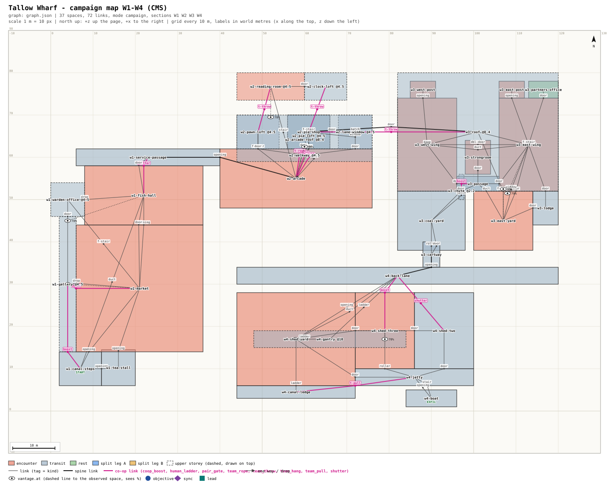

# mission-framework: sign-off - Tallow Wharf (campaign map)

## Picture
- Plan: [`PLAN.svg`](PLAN.svg) (scale 1 m = 10 px, north up, scale bar, grid 10 m). Magenta = forced co-op moves;
  dashed = upper storeys (lofts 4.5 m, roofs 8.4 m, crane gantry 10 m).
- Detail: [`SPEC.md`](SPEC.md) (rooms, routes, engine questions), [`graph.json`](graph.json) (validator: 0 errors, 6
  explained warnings).

## The map
1. A 120 x 80 m canal quarter at night, four sections in a row: W1 night market -> W2 arcade lofts -> W3 counting house
   -> W4 wharf sheds and the boat. 37 spaces, 9 guarded rooms, 35 guards (each mission spawns only its own sections).
2. **W1 night market:** boost up to the stall-roof gallery (the trimmer took his ladder home); one holds the broken
   fish hall shutter while the other crawls under (the exit).
3. **W2 arcade lofts:** human ladder or pull-up onto the loft walkway (no stair reaches it); throw over the lightwell
   between the loft rows; throw over the arcade lane to the counting house roof (the exit).
4. **W3 counting house:** rope from the roof into the west wing, or from the hoist beam into the coal yard; vent unlock
   (leg-up into the coal chute, unbolt the yard hatch and the barred door for the partner).
5. **W4 wharf sheds:** hold shed two's seized shutter; rope from the crane jib into shed three; pull-up from the canal
   ledge onto the jetty. All six approved kit moves are used; no section has a solo way through.
6. **Three Grey Coats:** W1 -> W2 -> W3 (crossing on the roof and coal yard, no step) -> W4: tally book on the gallery,
   Teale in the reading room, the rope down the hoist beam, the candle chest in shed three, the boat.
7. **Two-Key Ledger:** W2 -> W3 -> W4: the clerk's call in the pie loft, the throw to the counting house, one player per
   wing for the two keys, out through the coal chute, shed two's shutter, the boat.

## Intent check
1. Michael said (2026-10-24 ~22:50, M4): Three Grey Coats + Two-Key Ledger go on a new small campaign map, "graph ->
   spec + sign-off page -> greybox overnight". M3: every section forces a co-op traversal move, no solo bypass.
2. What you approve: the layout above and the forced co-op moves, before the greybox is built overnight.
3. What it does not do: no new moves beyond the approved kit; guard counts are estimates until the measured pass (V6).
4. What it costs: greybox GB0-GB6 plus the measured pass, about 14 h of slices. Three engine fits are flagged in SPEC
   "Engine questions": the rope is climb-up and 6 m in code today, the throw lands 3.2 m out (the lightwell and lane get
   narrowed), and the jetty lip goes to 4.3 m.

## The decision
Q: Build the Tallow Wharf greybox to this layout and these forced co-op moves?
- "Approve as specced"
- "Approve with changes (my notes below)"
- "Re-plan the map"

## Michael's pick
<!-- filled by the orchestrator: <YYYY-MM-DD ~HH:MM> picked: "<option text>" -->
