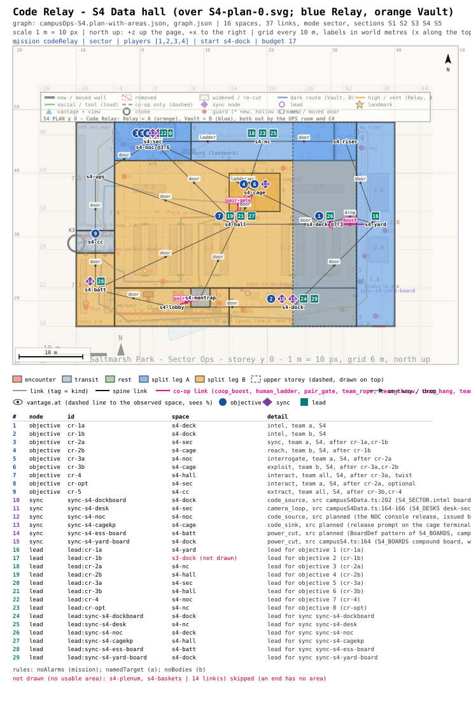

# mission-framework: sign-off - Code Relay (Sector Ops, campus S4)

## Picture
- Plan: [`PLAN.svg`](PLAN.svg) (scale 1 m = 10 px, north up). It sits over Sector Ops' ground-floor plan
  `S4-plan-0.svg`. Blue = Team Relay's rooms, orange = Team Vault's. Pins: objectives (circles), devices (diamonds),
  leads (squares), with a table below the plan.
- Detail: [`BEAT.md`](BEAT.md) (beat chart, radio lines, Graph notes), [`graph.json`](graph.json) (the mission graph).

## Intent check
1. Michael asked (2026-10-24 ~22:12, decision 4): first Sector Ops prototypes Split Shift and Code Relay, 4 players,
   parallel objectives for two teams or one player doing them all.
2. What this is: a 1-4 player mission in the data hall (S4). The cage terminal will only release the logs against a
   30-second code from the NOC. One team goes over the roof and makes the right officer issue the code. The other team
   waits in the cage and uses the code before it dies.
3. What the player does (co-op about 17 min, solo about 27 min, rated lower):
   - **1.** Relay crosses the generator compound and climbs to the roof, where the deck patrol's radio names the duty
     officer (Dunmore). At the same time Vault reads the door codes off the dock board.
   - **2.** Relay comes down the cable riser and loops the hall cameras at the security desk. At the same time Vault
     goes through the dark battery room into the server cage.
   - **3.** Relay questions Dunmore in the NOC (questioning Pryce spooks him), and he issues the release. Vault enters
     it at the cage terminal within 30 s (90 s solo, named in the briefing), and the logs download.
   - **4. Twist:** the release calls the mobile supervisor to the cage. Relay watches him from the NOC window and calls
     his position, and Vault keeps him off the cage.
   - **5.** Everyone leaves through the UPS room and down the colonnade.
   - **Optional (Relay):** wipe tonight's footage at the security desk (reward: one gadget charge).
4. Rules (in the briefing and the objective list):
   - Everyone: no alarms.
   - Relay: question only the duty officer.
   - Vault: no bodies found.
   - An alarm sends both teams back to the checkpoint. A team rule sends only that team back.
   - A solo player carries all three rules.
5. What it costs: paper only until you pick. Sector Ops' S4 plan already reserves every device. 7 of them are marked
   planned (the NOC release, the cage code prompt, the roster, the deck radio line, the seat placard, the footage
   drive, the riser-side keypad). Guard AI adds the supervisor's walk to the cage. The mission engine handles the named interrogation, the 30 s window and the
   per-team restart. Validator: 0 mission errors once it reads Sector Ops' `sync` key (a fix is in progress). There are
   7 warnings, each explained.

## The decision
Q: Approve Code Relay as specced?
- "Approve as specced (3 rules, the 30 s release, on S4)"
- "Approve with 2 rules (drop Vault's no-bodies, so a solo player carries 2)"
- "Move it to S5 (the Old House archive cage) instead"

## Michael's pick
<!-- filled by the orchestrator: <YYYY-MM-DD ~HH:MM> picked: "<option text>" -->
