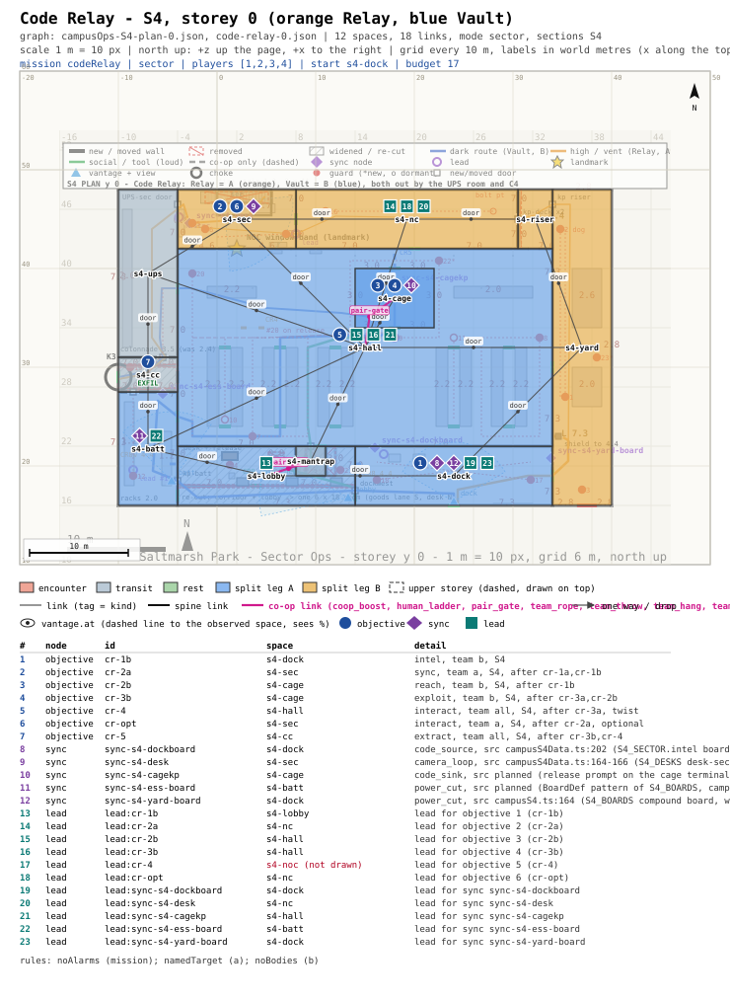
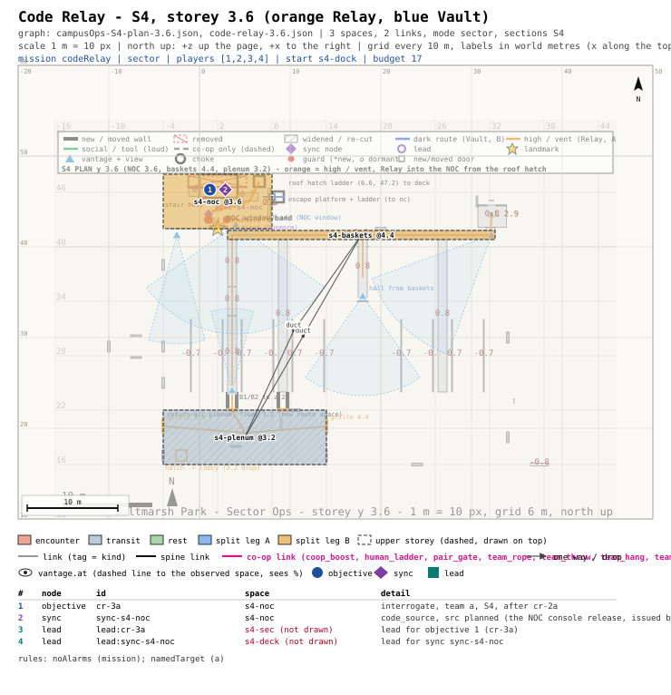
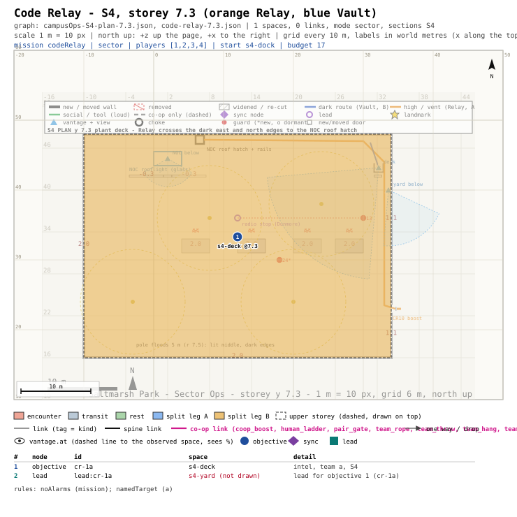

# mission-framework: sign-off - Code Relay (Sector Ops, campus S4)

## Picture
- Plans, one per storey (scale 1 m = 10 px, north up), each over Sector Ops' plan of that storey; orange = Team
  Relay's rooms, blue = Team Vault's (Sector Ops' S4 colours). Pins: objectives (circles), devices (diamonds), leads
  (squares), with a table below each plan.
  - Ground floor: [`PLAN-0.svg`](PLAN-0.svg) (the dock, battery room, hall, cage, security room and colonnade).
  - NOC mezzanine: [`PLAN-3.6.svg`](PLAN-3.6.svg) (the duty officer's step).
  - Roof deck: [`PLAN-7.3.svg`](PLAN-7.3.svg) (where Relay hears the duty officer's name).
- Detail: [`BEAT.md`](BEAT.md) (beat chart, radio lines, Graph notes), [`graph.json`](graph.json) (the mission graph).

## Intent check
1. Michael picked (2026-10-24 ~22:12, multiple choice): "Up to 2 strict rules per mission" and "first prototypes:
   Three Grey Coats + Two-Key Ledger (campaign, 2p) and Split Shift + Code Relay (Sector Ops, 4p)"; earlier that
   evening: "Sector Ops 4-player co-op, parallel objectives for two teams or a solo player doing them all, strict rules
   allowed too (global / per team / split)".
2. What this is: a 1-4 player mission in the data hall (S4). The cage terminal will only release the logs against a
   30-second code from the NOC. One team goes over the roof and makes the right officer issue the code. The other team
   waits in the cage and uses the code before it dies.
3. What the player does (co-op about 17 min, solo about 27 min, rated lower):
   - **1.** Relay crosses the generator compound and climbs to the roof (a leg-up onto the plant ladder; a lone Relay
     player goes up the cable riser instead), where the deck patrol's radio names the duty officer (Dunmore). At the
     same time Vault reads the door codes off the dock board.
   - **2.** Relay comes down the cable riser and loops the hall cameras at the security desk. At the same time Vault
     goes through the dark battery room into the server cage.
   - **3.** Relay questions Dunmore in the NOC (questioning Pryce spooks him), and he issues the release. Vault enters
     it at the cage terminal within 30 s (90 s solo, named in the briefing), and the logs download.
   - **4. Twist:** the release calls the mobile supervisor to the cage. Relay watches him from the NOC window and calls
     his position, and Vault keeps him off the cage.
   - **5.** Everyone leaves through the UPS room and down the colonnade.
   - **Optional (Relay):** wipe tonight's footage at the security desk (reward: one gadget charge).
4. Rules (2, within your cap; in the briefing and the objective list):
   - Everyone: no alarms.
   - Relay: question only the duty officer.
   - Relay carries 2, Vault 1, a solo player 2.
   - An alarm sends both teams back to the checkpoint. Breaking Relay's rule sends only Relay back.
5. What it costs: paper only until you pick. Sector Ops' S4 plan already reserves every device. 7 of them are marked
   planned (the NOC release, the cage code prompt, the roster, the deck radio line, the seat placard, the footage
   drive, the riser-side keypad). Guard AI adds the supervisor's walk to the cage. The mission engine handles the
   named interrogation, the 30 s window and the per-team restart. Validator, on Sector Ops' latest campus plan: 0
   errors; 1 mission warning, by design (the colonnade exit is the section's choke; BEAT.md Graph notes).

## The decision
Q: Approve Code Relay as specced?
- "Approve as specced (2 rules: no alarms, Relay questions only the duty officer)"
- "Lift your 2-rule cap for this mission (add Vault: no bodies found; a solo player then carries 3)"
- "Move it to S5 (the Old House archive cage) instead"

## Michael's pick
<!-- filled by the orchestrator: <YYYY-MM-DD ~HH:MM> picked: "<option text>" -->
