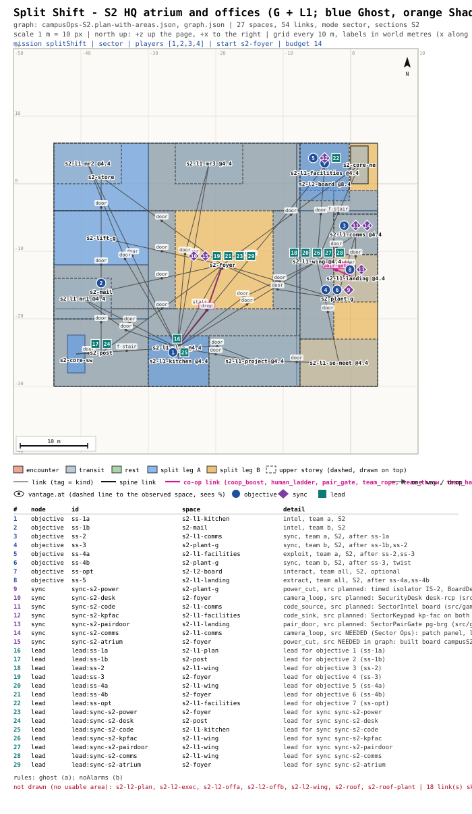

# mission-framework: sign-off - Split Shift (Sector Ops, campus S2)

## Picture
- Plan: [`PLAN.svg`](PLAN.svg) (scale 1 m = 10 px, north up). Ground floor and first floor drawn together; blue = Team
  Ghost's rooms, orange = Team Shadow's. Pins: objectives (circles), devices (diamonds), leads (squares), table below the plan.
- Detail: [`BEAT.md`](BEAT.md) (beat chart, radio lines, Graph notes), [`graph.json`](graph.json) (the mission graph).

## Intent check
1. Michael asked (2026-10-24 ~22:12, decision 4): first Sector Ops prototypes Split Shift and Code Relay, 4 players,
   parallel objectives for two teams or one player doing them all.
2. What this is: a 1-4 player mission in the HQ block (S2). One team works upstairs and is never seen; the other works
   the ground floor and cuts the power so the first can hack the building computer.
3. What the player does (co-op about 14 min, solo about 23 min, rated lower):
   - **1.** Ghost climbs the post room's fire stair and overhears the facilities code at the first-floor kitchen.
     At the same time Shadow takes the plant log from the mail room cages.
   - **2.** Ghost loops the ground-floor cameras at the comms room panel, which opens the foyer for Shadow.
   - **3.** Shadow uses the plant log to cut the east wing at the plant-room switchgear. The facilities officer leaves his desk.
   - **4.** Ghost uses the code to get into the dark facilities office and hacks the terminal. **Twist:** the officer
     brings the reception officer with him, and Shadow must hold the plant room dark. The atrium board can split them.
   - **5.** Everyone meets at the bridge landing and crosses the glazed bridge.
   - **Optional (either team):** photograph the lighting schedule in the second-floor board room (reward: one syringe).
4. Rules (2, one per team, in the briefing and the objective list):
   - Ghost: never seen. That includes Shadow being seen upstairs.
   - Shadow: no alarms (no panel, no camera).
   - A broken rule sends that team back to the section checkpoint.
5. What it costs: paper only until you pick. After that, Sector Ops adds 2 devices and changes 1 to the HQ plan (BEAT.md
   Graph notes), Guard AI adds 1 reaction, and the mission engine handles a per-team restart. Validator: 0 mission
   errors once the validator reads Sector Ops' `sync` key (a fix is in progress) and the bridge pair door gets its solo
   line. There are 6 warnings, each explained.

## The decision
Q: Approve Split Shift as specced?
- "Approve as specced (Sector Ops adds the comms-room camera panel and the held east-wing cut)"
- "Approve, but move it onto Sector Ops' planned S2 devices (Shadow loops the cameras at the reception desk, the cut is a 45 s timer)"
- "Rework: send it back with my notes"

## Michael's pick
<!-- filled by the orchestrator: <YYYY-MM-DD ~HH:MM> picked: "<option text>" -->
