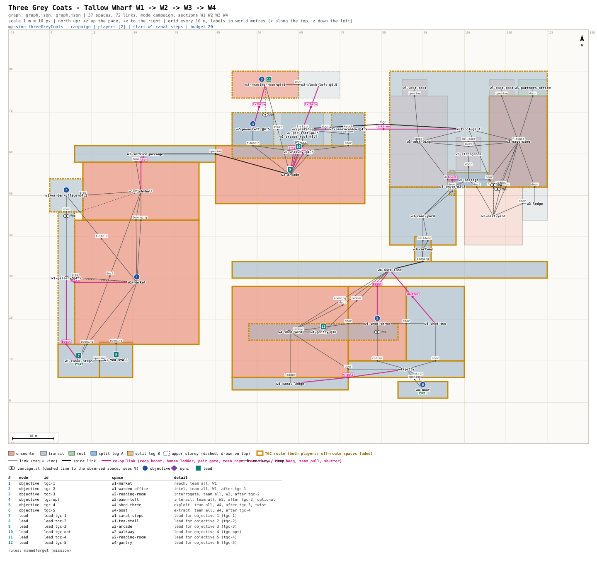

# mission-framework: sign-off - Three Grey Coats (campaign, Tallow Wharf)

Signed off by Michael 2026-10-25 ~18:05 (his pick is at the bottom).

## Picture
- Plan: [`PLAN.svg`](PLAN.svg) (scale 1 m = 10 px, north up, canal along the bottom). Gold edges = the mission's
  route (both players); the other spaces are faded. Pins: objectives (circles), leads (squares), table below the plan.
  Magenta links are the co-op moves.
- Detail: [`BEAT.md`](BEAT.md) (beat chart, roles, radio, Graph notes), [`graph.json`](graph.json) (the mission graph).

## Intent check
1. Michael said (2026-10-24 ~22:45): "All campaign missions are strictly coop and cannot be completed solo, must have
   forced coop traversal to proceed". At ~22:12 he picked Three Grey Coats and Two-Key Ledger as the first campaign
   prototypes, and at ~22:50 put them on a new small map: "If it's ready before I'm awake, continue to make progress".
2. What this is: a 2-player night mission across Tallow Wharf (about 20 min). Three couriers in the same grey coat
   leave the canal market. The players work out which one is Pell's, question him quietly in the arcade lofts, and
   take the cipher from a tea chest in shed three.
3. What the players do (beat chart):
   - **1. W1 market (3 min):** from the canal steps, find the three coats under the lit fish hall clock. One boosts the
     other up onto the stall-roof gallery.
   - **2. W1 (4 min):** split leads. The one on the gallery reads the warden's tally book. The one on the floor listens
     to the porters at the tea stall. Together the two halves point to the black umbrella. Out through the fish hall
     shutter: one holds it, the other crawls under.
   - **3. W2 lofts (5 min):** a boost and the rope onto the loft walkway, a throw over the lightwell, then one player
     questions Teale in the reading room while the other watches from the arcade roof. He says: "Shed three. Candle on
     the lid." The only way back out is down the lit public stair; the watcher calls it clear, then pulls the other back
     up onto the walkway, and both climb through the corner loft to the arcade roof.
   - **Crossing W3 (no step):** a throw over the arcade lane onto the counting-house roof, down the fire escape into the
     east wing, then the coal chute: one is boosted in, unbolts the yard hatch and unbars the yard door for the other.
     Both come out in the coal yard, then the cartway to the wharf lane.
   - **4. W4 sheds (4 min), twist:** one boosts the other in through shed three's lane-side window for the candle chest,
     then climbs the crane to the gantry to watch. Teale's two minders arrive and walk the yard. The cipher was in the
     chest all along.
   - **5. W4 (3 min):** both get to the boat under the crane's red lamp. A pull-up gets the second player from the canal
     ledge onto the jetty; the gangway is the quiet way aboard.
   - **Optional (W2, 2 min):** read Pell's courier rota in the pawnbroker's loft. No reward (campaign optional
     objectives give none, Michael's Q19 "None (Recommended)"); the rota names the nights.
4. Rule (1, the whole mission): "Rule - question only Pell's courier." It is the last line of the briefing and sits
   under the title in the objective list. Questioning a decoy (Fenn or Garrow), or killing Teale before he talks,
   breaks it. LANTERN says the line, and the team goes back to the arcade checkpoint. Teale is now unalerted in the
   clock-mender's back loft, so the retry needs a new route. Assumed after the pick (BRIEF A24, to confirm with
   Michael): knocking Teale out before he talks restarts the section with Teale still at his table (a protected
   character, G353), so the mission can never get stuck. No markers: the objective lines name the places, and the hint layer is
   off by default.
5. What it costs: paper only until you pick. After that, the mission is wired into the wharf greybox (the guards and
   missions slice), and the section restart needs one engine exception: it has to remember that Teale was spooked.
   Validator: 0 errors, 6 warnings, all on the map's own custom-size spaces (BEAT.md Graph notes); since Q19 the
   optional has no reward, so the validator gives 1 error until it is updated to match.

## The decision
Q: Approve Three Grey Coats as specced?
- "Approve as specced (after a broken rule, W2 restarts with Teale moved to the clock-mender's loft)"
- "Approve, but a restart puts Teale back at his table (simpler engine; the bolt point is then used only when the rule is off)"
- "Rework: send it back with my notes"

## Michael's pick
2026-10-25 ~18:05 picked: "He moves (Recommended)" (option 1: after a broken rule, W2 restarts with Teale in the
clock-mender's loft). Signed off.
