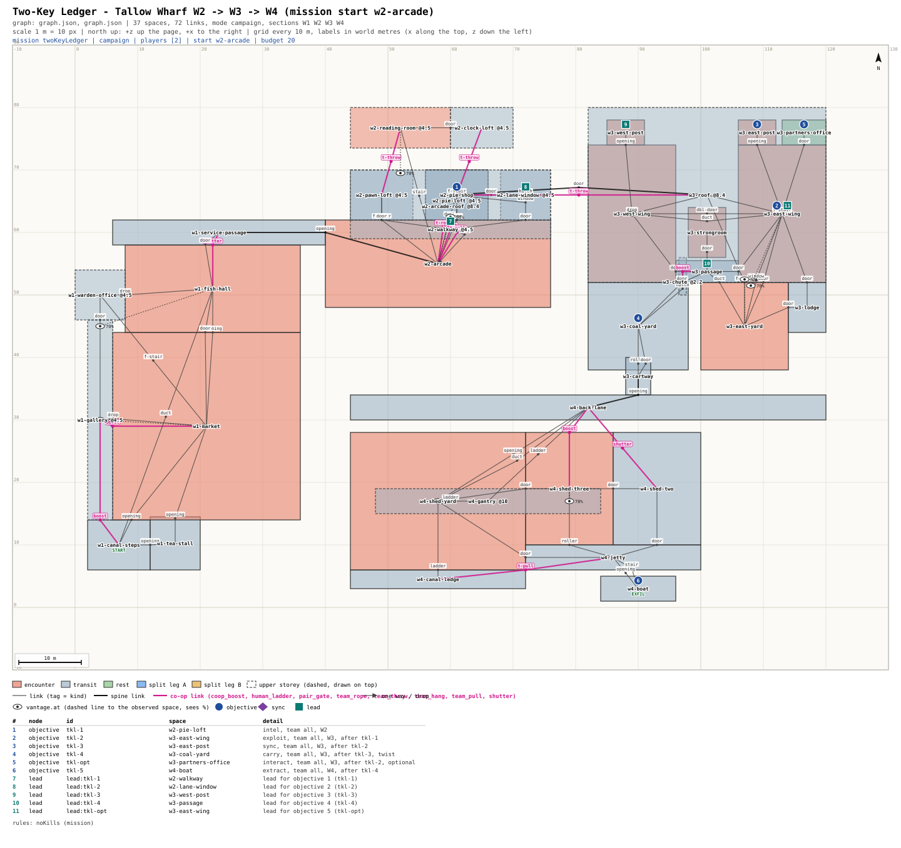

# mission-framework: sign-off - Two-Key Ledger (campaign, Tallow Wharf W2 -> W3 -> W4)

## Picture
- Plan: [`PLAN.svg`](PLAN.svg) (scale 1 m = 10 px, north up). The whole Tallow Wharf map; Two-Key Ledger uses W2 (arcade lofts),
  W3 (counting house) and W4 (wharf sheds), W1 is drawn for context. Magenta links are co-op moves. Pins: objectives
  (circles), leads (squares), table below the plan.
- Detail: [`BEAT.md`](BEAT.md) (beat chart, radio lines, Graph notes), [`graph.json`](graph.json) (the mission graph).

## Intent check
1. Michael said (2026-10-24 ~22:45): "All campaign missions are strictly coop and cannot be completed solo, must have
   forced coop traversal to proceed". At ~22:12 he picked Three Grey Coats and Two-Key Ledger as the first campaign
   prototypes, and at ~22:50 put them on a new small map: "If it's ready before I'm awake, continue to make progress".
2. What this is: a 2-player, about 20 min mission. Night Shift steals a counting house's ledger from a strongroom whose
   door needs two keys turned at once, a wing apart, without killing anyone.
3. What the players do:
   - **1. W2, 4 min (intel):** a boost and a pull-up onto the loft walkway, overhear the night clerk: the east gate
     code is the founding year on the brass plate. One reads the plate from the corner loft window.
   - **2. W3, 4 min (exploit):** team throw over the arcade lane to the counting house roof. The pair splits: one drops
     through the light-well lantern into the west wing, the other takes the east gate with the code.
   - **3. W3, 5 min (sync):** each holds a key post, TALLY counts, both turn within 1 s. A miss springs both keys back.
   - **4. W3, 4 min (twist):** the open strongroom rings a bell in the porter's lodge and the porter walks in by the
     east gate. The team leaves with the ledger by the coal chute: one gives a leg-up, the other crawls out by the yard
     hatch and unbars the coal yard door, and the booster follows through it.
   - **5. W4, 3 min (extract):** one holds shed two's shutter, the other crawls under and goes through the shed to the
     jetty. The holder goes round by the shed yard and the quay ladder to the canal ledge and is pulled up onto the
     jetty. Both board the boat.
   - **Optional (W3):** copy the partners' day book in the east wing office (reward: one syringe).
4. Rule (1, whole mission): no kills; knock-outs are fine. Signposted in the briefing ("Rule: no kills. Knock them down
   if you must."), under the objective-list title ("Rule - no kills."), and by LANTERN's line on a break. A kill sends
   both players back to that section's checkpoint; the mission continues. Every guarded space keeps a dark route and a
   spot to knock a guard out unseen. Hints (off by default) name places only: no markers.
5. What it costs: paper only until you pick. After that: the map greybox, a synced key-turn device, Guard AI
   adds one reaction (a bell sends the porter to it), the mission engine handles the section restart. Validator: 0
   errors; 6 warnings, all the map's own (5 custom room sizes, the coal chute's 1.2 m crouch width), none from the
   mission.

## The decision
Q: Approve Two-Key Ledger as specced?
- "Approve as specced (no kills, the bell sends the porter, the coal chute exit)"
- "Approve, but script the porter's walk (no Guard AI reaction; he always walks in 60 s after the door opens)"
- "Rework: send it back with my notes"

## Michael's pick
<!-- filled by the orchestrator: <YYYY-MM-DD ~HH:MM> picked: "<option text>" -->
