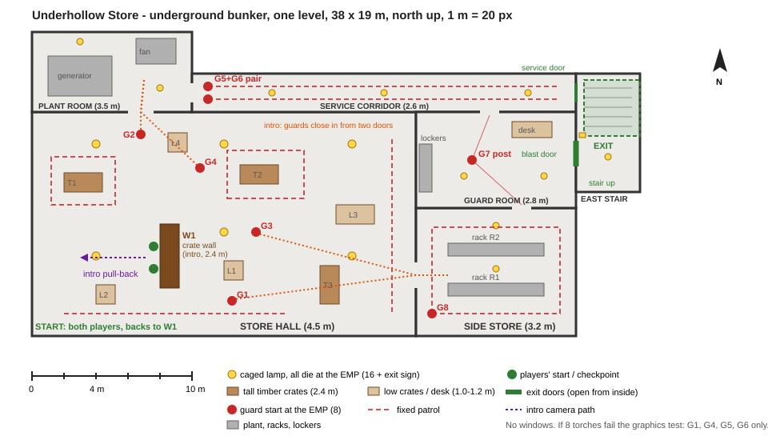

# piano-escape: sign-off 1 - Aldgrave Piano Works (the piano escape scene)
Owner: Night Shift | Campaign Build. Status: current.

## Picture
- Plan: `docs/piano-escape/map-plan.svg` (scale 1 m = 20 px; north up; drawn inline below)
- Before (changes only): none, a new test map.

Inline copy of the plan (SVG)

<svg xmlns="http://www.w3.org/2000/svg" viewBox="0 0 960 560" width="960" height="560" font-family="Arial, Helvetica, sans-serif" font-size="11">
  <title>Aldgrave Piano Works - piano escape map plan (1 m = 20 px)</title>
  <rect x="0" y="0" width="960" height="560" fill="#ffffff"/>
  <text x="40" y="24" font-size="15" font-weight="bold" fill="#222">Aldgrave Piano Works - one storey, 40 x 19 m, north up, 1 m = 20 px</text>

  <!-- rooms -->
  <g fill="#f3efe6" stroke="#333" stroke-width="3">
    <rect x="40" y="92" width="240" height="328"/>
    <rect x="280" y="140" width="360" height="280"/>
    <rect x="280" y="92" width="360" height="48"/>
    <rect x="400" y="40" width="80" height="52"/>
    <rect x="640" y="280" width="200" height="140"/>
    <rect x="640" y="40" width="200" height="240"/>
  </g>
  <rect x="40" y="92" width="80" height="88" fill="#e9e3d6" stroke="#333" stroke-width="2"/>
  <rect x="840" y="40" width="50" height="50" fill="#e8f5e9" stroke="#2e7d32" stroke-width="2" stroke-dasharray="5 3"/>

  <!-- moon / city glow (faint, under the meter's dark band) -->
  <g fill="#c9dcff" opacity="0.55">
    <ellipse cx="340" cy="196" rx="32" ry="16"/>
    <ellipse cx="430" cy="196" rx="32" ry="16"/>
    <ellipse cx="520" cy="196" rx="32" ry="16"/>
    <ellipse cx="822" cy="180" rx="16" ry="44"/>
    <ellipse cx="826" cy="345" rx="10" ry="16"/>
  </g>

  <!-- windows -->
  <g stroke="#1e63d6" stroke-width="5">
    <line x1="310" y1="140" x2="370" y2="140"/>
    <line x1="400" y1="140" x2="460" y2="140"/>
    <line x1="490" y1="140" x2="550" y2="140"/>
    <line x1="840" y1="124" x2="840" y2="172"/>
    <line x1="840" y1="192" x2="840" y2="240"/>
    <line x1="840" y1="330" x2="840" y2="360"/>
  </g>

  <!-- doors (gaps) -->
  <g stroke="#f3efe6" stroke-width="5">
    <line x1="280" y1="300" x2="280" y2="340"/>
    <line x1="280" y1="104" x2="280" y2="128"/>
    <line x1="120" y1="140" x2="120" y2="160"/>
    <line x1="560" y1="140" x2="584" y2="140"/>
    <line x1="428" y1="92" x2="452" y2="92"/>
    <line x1="640" y1="104" x2="640" y2="128"/>
    <line x1="640" y1="356" x2="640" y2="380"/>
    <line x1="780" y1="280" x2="804" y2="280"/>
  </g>
  <line x1="840" y1="52" x2="840" y2="76" stroke="#2e7d32" stroke-width="6"/>
  <line x1="120" y1="420" x2="200" y2="420" stroke="#888" stroke-width="6" stroke-dasharray="4 3"/>
  <text x="122" y="436" fill="#666">roller shutter (chained)</text>

  <!-- cover -->
  <g fill="#b9a27c" stroke="#6d5a3a" stroke-width="1">
    <rect x="80" y="268" width="44" height="32"/>
    <rect x="160" y="218" width="44" height="32"/>
    <rect x="60" y="200" width="44" height="30"/>
    <rect x="200" y="336" width="40" height="24" fill="#d8c8a6"/>
    <rect x="400" y="392" width="160" height="20"/>
    <rect x="600" y="200" width="28" height="160" fill="#d8c8a6"/>
    <rect x="740" y="320" width="80" height="80" fill="#cfcfcf" stroke="#777"/>
    <rect x="660" y="290" width="28" height="40" fill="#d8c8a6"/>
    <rect x="790" y="240" width="40" height="20" fill="#d8c8a6"/>
  </g>
  <g fill="#8c8c8c" stroke="#555" stroke-width="1">
    <rect x="320" y="346" width="32" height="28"/><rect x="390" y="346" width="32" height="28"/><rect x="460" y="346" width="32" height="28"/><rect x="530" y="346" width="32" height="28"/>
    <rect x="320" y="276" width="32" height="28"/><rect x="390" y="276" width="32" height="28"/><rect x="460" y="276" width="32" height="28"/><rect x="530" y="276" width="32" height="28"/>
    <rect x="320" y="206" width="32" height="28"/><rect x="390" y="206" width="32" height="28"/><rect x="460" y="206" width="32" height="28"/><rect x="530" y="206" width="32" height="28"/>
  </g>
  <g fill="#3b3b3b">
    <rect x="673" y="205" width="54" height="30" rx="8"/>
    <rect x="743" y="145" width="54" height="30" rx="8"/>
    <rect x="673" y="85" width="54" height="30" rx="8"/>
  </g>

  <!-- intro wall W1 -->
  <rect x="157" y="280" width="6" height="80" fill="#7a2e12"/>
  <text x="52" y="311" fill="#7a2e12" font-weight="bold">W1 intro wall (3 m)</text>

  <!-- lamps: all electric, all die at the EMP -->
  <g fill="#ffd54a" stroke="#a07800" stroke-width="1">
    <circle cx="100" cy="360" r="5"/><circle cx="220" cy="360" r="5"/><circle cx="100" cy="260" r="5"/><circle cx="220" cy="260" r="5"/><circle cx="180" cy="150" r="5"/><circle cx="250" cy="150" r="5"/>
    <circle cx="340" cy="350" r="5"/><circle cx="460" cy="350" r="5"/><circle cx="580" cy="350" r="5"/><circle cx="340" cy="220" r="5"/><circle cx="460" cy="220" r="5"/><circle cx="580" cy="220" r="5"/>
    <circle cx="340" cy="116" r="4"/><circle cx="460" cy="116" r="4"/><circle cx="580" cy="116" r="4"/><circle cx="440" cy="66" r="4"/>
    <circle cx="700" cy="350" r="4"/><circle cx="780" cy="300" r="4"/>
    <circle cx="690" cy="200" r="4"/><circle cx="790" cy="200" r="4"/><circle cx="690" cy="100" r="4"/><circle cx="790" cy="100" r="4"/>
    <rect x="828" y="60" width="8" height="6"/>
  </g>

  <!-- guard patrols -->
  <g fill="none" stroke="#c62828" stroke-width="1.6" stroke-dasharray="6 4">
    <line x1="80" y1="384" x2="240" y2="384"/>
    <polygon points="150,260 220,260 220,200 150,200"/>
    <polygon points="304,382 444,382 444,252 304,252"/>
    <line x1="580" y1="380" x2="580" y2="170"/>
    <line x1="300" y1="110" x2="620" y2="110"/>
    <line x1="300" y1="122" x2="620" y2="122"/>
    <polygon points="664,256 760,256 810,190 810,104 740,56 664,56"/>
  </g>
  <g stroke="#c62828" stroke-width="1" opacity="0.7">
    <line x1="720" y1="300" x2="645" y2="368"/>
    <line x1="720" y1="300" x2="792" y2="284"/>
  </g>
  <!-- guard posts (start at the EMP) -->
  <g fill="#c62828">
    <circle cx="220" cy="372" r="6"/><circle cx="230" cy="170" r="6"/><circle cx="260" cy="320" r="6"/><circle cx="260" cy="140" r="6"/>
    <circle cx="300" cy="110" r="6"/><circle cx="300" cy="122" r="6"/><circle cx="720" cy="300" r="6"/><circle cx="664" cy="256" r="6"/>
  </g>
  <g fill="#c62828" font-weight="bold">
    <text x="204" y="366">G1</text><text x="212" y="166">G2</text><text x="240" y="314">G3</text><text x="242" y="136">G4</text>
    <text x="304" y="104">G5+G6 pair</text><text x="706" y="318">G7 post</text><text x="668" y="250">G8</text>
  </g>

  <!-- intro: guards close in from two sides (hall door, corridor door), slow motion -->
  <g stroke="#e65100" stroke-width="2" stroke-dasharray="2 3" fill="none">
    <polyline points="330,316 284,318 262,320"/>
    <polyline points="330,330 284,330 222,370"/>
    <polyline points="330,116 284,116 262,138"/>
    <polyline points="330,116 284,118 232,168"/>
  </g>
  <text x="126" y="186" fill="#e65100" font-size="10">intro: guards close in</text>
  <text x="126" y="197" fill="#e65100" font-size="10">from two doors</text>

  <!-- players and intro camera -->
  <g fill="#2e7d32"><circle cx="152" cy="336" r="6"/><circle cx="152" cy="308" r="6"/></g>
  <text x="44" y="404" fill="#2e7d32" font-weight="bold">START: both players, backs to W1</text>
  <line x1="140" y1="322" x2="66" y2="322" stroke="#6a1b9a" stroke-width="2" stroke-dasharray="3 3"/>
  <polygon points="60,322 70,317 70,327" fill="#6a1b9a"/>
  <text x="44" y="344" fill="#6a1b9a">intro pull-back</text>
  <text x="846" y="104" fill="#2e7d32" font-weight="bold">EXIT</text>
  <text x="846" y="116" fill="#2e7d32">porch</text>

  <!-- room labels -->
  <g fill="#333" font-weight="bold" font-size="12">
    <text x="128" y="112">LOADING DOCK (6 m)</text>
    <text x="46" y="110" font-size="10">dock office</text>
    <text x="400" y="164">ASSEMBLY HALL (7 m)</text>
    <text x="300" y="136" font-size="10">CORRIDOR (3 m)</text>
    <text x="406" y="56" font-size="10">tea room</text>
    <text x="648" y="412">VARNISH ROOM (4 m)</text>
    <text x="700" y="272">SHOWROOM (4.5 m)</text>
  </g>
  <g fill="#555" font-size="10">
    <text x="88" y="288">C1</text><text x="168" y="238">C2</text><text x="68" y="219">C3</text><text x="400" y="406">timber rack</text><text x="562" y="372">bench</text>
    <text x="744" y="364">spray booth</text><text x="330" y="200">frames (1.0 m) x 12</text><text x="676" y="138">grand pianos</text>
    <text x="300" y="154" fill="#1e63d6">clerestory windows (high, moonlight)</text>
  </g>

  <!-- scale bar and north -->
  <g stroke="#222" stroke-width="2">
    <line x1="40" y1="470" x2="240" y2="470"/>
    <line x1="40" y1="464" x2="40" y2="476"/><line x1="80" y1="466" x2="80" y2="474"/><line x1="120" y1="466" x2="120" y2="474"/><line x1="160" y1="466" x2="160" y2="474"/><line x1="200" y1="466" x2="200" y2="474"/><line x1="240" y1="464" x2="240" y2="476"/>
  </g>
  <text x="36" y="490">0</text><text x="112" y="490">4 m</text><text x="232" y="490">10 m</text>
  <g transform="translate(920,90)">
    <polygon points="0,-30 9,0 0,-6 -9,0" fill="#222"/>
    <text x="-5" y="16" font-weight="bold">N</text>
  </g>

  <!-- legend -->
  <g font-size="11">
    <circle cx="290" cy="468" r="5" fill="#ffd54a" stroke="#a07800"/><text x="300" y="472">lamp (electric: all die at the EMP), 22 + exit sign</text>
    <line x1="284" y1="490" x2="300" y2="490" stroke="#1e63d6" stroke-width="5"/><text x="306" y="494">window (pale blue: faint glow, night vision only)</text>
    <circle cx="290" cy="512" r="6" fill="#c62828"/><text x="300" y="516">guard start at the EMP (8)</text>
    <line x1="460" y1="512" x2="490" y2="512" stroke="#c62828" stroke-width="1.6" stroke-dasharray="6 4"/><text x="496" y="516">fixed patrol</text>
    <rect x="284" y="526" width="14" height="10" fill="#b9a27c" stroke="#6d5a3a"/><text x="304" y="535">tall cover (1.8-2.5 m)</text>
    <rect x="440" y="526" width="14" height="10" fill="#d8c8a6" stroke="#6d5a3a"/><text x="460" y="535">low cover (1.0-1.2 m)</text>
    <circle cx="620" cy="468" r="6" fill="#2e7d32"/><text x="630" y="472">players' start / checkpoint</text>
    <line x1="612" y1="490" x2="632" y2="490" stroke="#2e7d32" stroke-width="6"/><text x="638" y="494">exit door (opens from inside)</text>
    <line x1="612" y1="512" x2="632" y2="512" stroke="#6a1b9a" stroke-width="2" stroke-dasharray="3 3"/><text x="638" y="516">intro camera path</text>
    <text x="612" y="535" fill="#555">If 8 torches fail the graphics test: G1, G4, G5, G6 only.</text>
  </g>
</svg>

**What the plan shows.** A small 1920s piano works on one floor, 40 by 19 metres: loading dock, assembly hall,
corridor with a tea room, varnish room, showroom with the front door. The two operators start with their backs to the
dock's brick wall (W1). 8 guards (red) on fixed rounds; the corridor pair is the one to take together. 22 lamps
(yellow) all die at the EMP; after that the only light is the guards' torches and a very faint moon and city glow
through the windows (blue), seen only through night vision. Two ways to the front door: the corridor, or the hall and
varnish room.

**The opening (against the 2 min 14 s piano track).** 0-3 s black. 3-9 s fade in on the chest, empty pistol, calm
breathing; a dry click of the empty gun. 16-30 s the camera slowly pulls back: the wall, the partner, bullets flying
past from two sides in slow motion. 30-38 s on the music's first swell: surrounded, four guards closing in slow motion
from two doors. 38 s: one button press sets off the EMP, every light dies, torches click on, and you have control.
Hold Back to skip to the EMP; no replay after a restart.

**If 8 torches are too heavy for the graphics card** (one test decides): the same map with 4 guards (G1, G4 and the
corridor pair), never a guard without a torch.

## Rules this scene skips (your click approves these, for this scene only)
- No layout checker or test-bot runs: your walk replaces them.
- Two ways to the exit, not three plus a secret.
- Guard numbers per room are not graded.
- No pacing chart, teach-then-test beats or extra things to play with in each room.
- No security devices (cameras, lasers, keypads) and no security sheet.
- One player may play it (the standard says exactly two).
- The corridor pair is the only must-do teamwork moment; no forced climbing or boosting together.
- No designed split-up points, hidden rewards, lit choke points or extra test checklist; this plan is the map's only spec
  (no separate map sheet).

## Intent check (5 lines)
1. Michael said: "a black screen, slowly fading in to the characters upper chest ... holding an empty pistol ...
   very tense and quiet, with them brutally taking down guards in the shadows" (2026-10-26 ~19:20), and "they should
   activate an EMP which knocks out all the lights ... the mission will play in pure darkness" (~19:55).
2. What this is: a one-off co-op scene in a small dark piano works, with its own piano music and opening shot.
3. What changes for the player: watch the slow opening, press the EMP, then knife every guard in the dark and walk out
   the front door together.
4. What it does not do: no score, no saves, no change to the campaign, Sector Ops or Marlow Yard; knife kills are
   allowed only here.
5. What it costs: 4 build pieces (about 2 days of builders) plus work from 3 other teams (knife moves, guard torches,
   the blackout lighting); it stays hidden behind its own switch and shows in the preview.

## The decision
Q: Build the piano escape to this plan, with the rule skips above (this scene only)?
- "Approve, build it (Recommended)"
- "Change it first"

## Michael's pick
<!-- filled by the orchestrator -->
